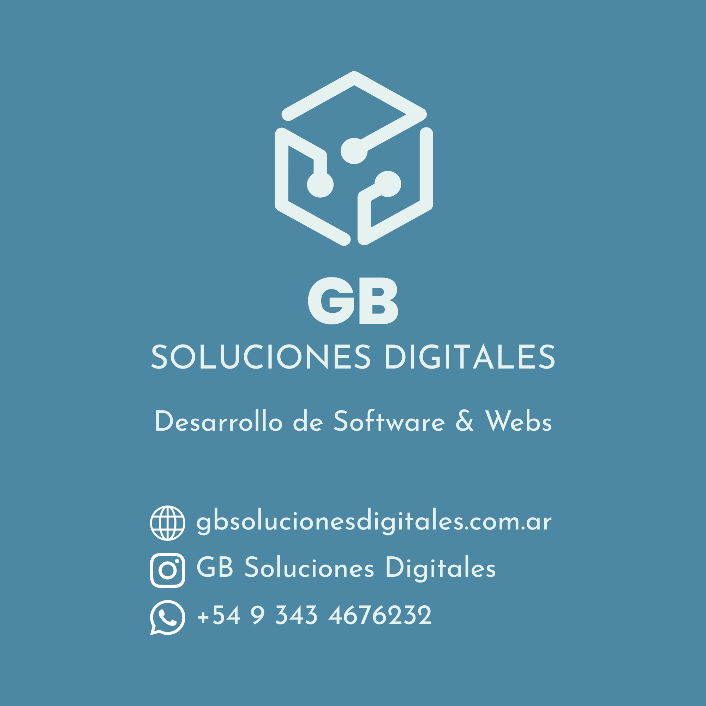

  

<h1 align="center">GB Soluciones Digitales</h1>

<h3 align="center">
  Transformamos ideas en soluciones digitales.
</h3>

  Desarrollamos software a medida para simplificar procesos,
  optimizar la gestión y potenciar negocios.

  <a href="https://www.gbsolucionesdigitales.com.ar/">
    🌐 Sitio web
  </a>
  ·
  <a href="mailto:gbsolucionesdigitales@gmail.com">
    ✉️ Contacto
  </a>

---

## 🚀 Sobre nosotros

En **GB Soluciones Digitales** nos especializamos en el diseño y desarrollo de software a medida, creando herramientas digitales que responden a las necesidades reales de cada negocio.

Acompañamos a empresas y emprendimientos en la transformación de sus procesos, desarrollando soluciones modernas, escalables y fáciles de utilizar.

Nuestro objetivo es convertir ideas y necesidades en herramientas que generen valor.

## 💡 Nuestros servicios

<table>
  <tr>
    <td width="50%">
      <h3>💻 Desarrollo de software</h3>
      Aplicaciones web personalizadas, diseñadas según las necesidades de cada cliente.
    </td>
    <td width="50%">
      <h3>📊 Sistemas de gestión</h3>
      Herramientas para administrar operaciones, centralizar información y mejorar procesos.
    </td>
  </tr>
  <tr>
    <td width="50%">
      <h3>⚙️ Automatización</h3>
      Digitalización de tareas y procesos para reducir tiempos y optimizar recursos.
    </td>
    <td width="50%">
      <h3>🔗 APIs e integraciones</h3>
      Desarrollo de servicios e integraciones para conectar sistemas y plataformas.
    </td>
  </tr>
</table>

## 🛠️ Tecnologías

Trabajamos con herramientas modernas y tecnologías confiables para desarrollar soluciones eficientes.

**Frontend**
 
- React
- Vite
- JavaScript
- HTML5 / CSS3

**Backend**

- Python / FastAPI
- C# / .NET
- Java / Spring Boot

**Bases de datos**

- PostgreSQL
- MySQL

**Herramientas y tecnologías complementarias**

- Git & GitHub
- Docker
- REST APIs

## 📂 Nuestros proyectos

Desarrollamos soluciones para distintos rubros y necesidades, desde aplicaciones web hasta sistemas de gestión empresarial.

En esta organización encontrarás proyectos que reflejan nuestro trabajo, experiencia y compromiso con la calidad del software.

## 📂 Proyectos Destacados de la Agencia

- **[MM Entrenamiento](https://github.com/Brian13b/MM_Entrenamiento)**: PWA para la gestión inteligente de turnos, horarios dinámicos y retención de alumnos en centros de entrenamiento.
- **[Sistema Integral DaniPak](https://github.com/GB-Soluciones-Digitales/sistema_gestion_logistica_danipak)**: Sistema de gestión logística y encomiendas con arquitectura offline-first (FastAPI + React).
- **[DripGestión](https://github.com/Brian13b/dripgestion_backend)**: SaaS multi-tenant para distribución de agua con control de rutas y PWA offline.

## 🤝 ¿Tenés un proyecto en mente?

Nos interesa conocer nuevas ideas y ayudar a convertirlas en soluciones concretas.

Si necesitás desarrollar un sistema desde cero, digitalizar procesos o mejorar las herramientas que utiliza tu negocio, podemos ayudarte.

  <a href="https://www.gbsolucionesdigitales.com.ar/">
    <strong>Conocé más sobre nosotros</strong>
  </a>

  📧 gbsoluciondigital@gmail.com

---

  <i>GB Soluciones Digitales · Software pensado para hacer crecer tu negocio.</i>

